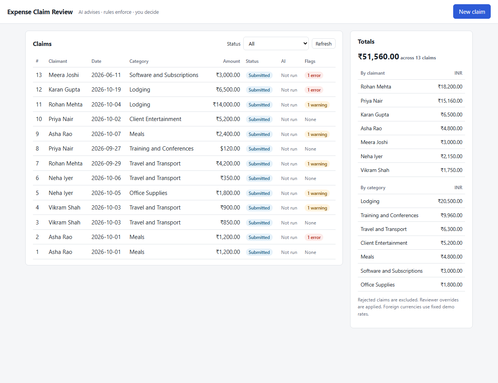
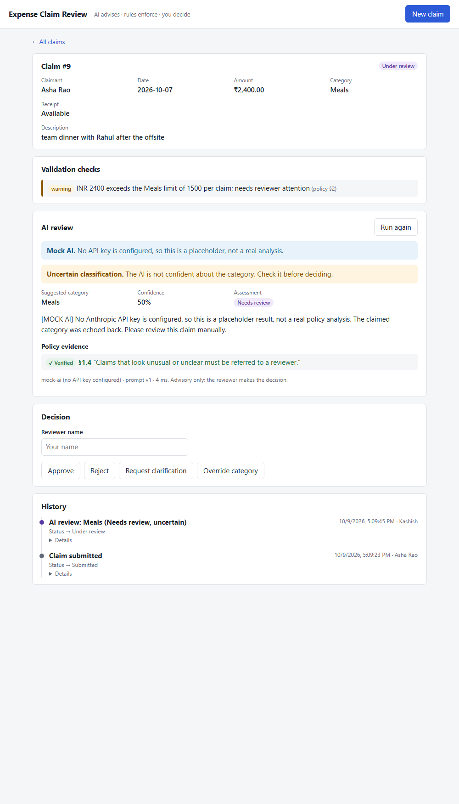

# Expense Claim Review

An internal web app for a finance reviewer who checks employee expense claims against the company expense policy.

Each claim goes through three layers, and each layer has a different job:

| Layer | Who | What it does | Can it decide? |
|---|---|---|---|
| **Rules** | Plain TypeScript | Duplicates, totals, missing receipts, category limits, dates and required fields | No. It flags problems for the reviewer. |
| **AI advisor** | Claude, via the Anthropic API | Suggests a category, finds the relevant policy clauses, explains the likely outcome, quotes its evidence and lists questions for the claimant | No. Its output is advice, and it is checked before it is shown. |
| **Reviewer** | A person | Approves, rejects, asks for clarification, or overrides the category | Yes, and every action is logged. |

The app does not reimburse anyone and does not give financial, tax or legal advice.



## A typical review

1. **Submit a claim** (claimant, date, category, amount, currency, description, receipt yes/no). The rules run immediately and their findings are saved with the claim: for example *"Exact duplicate of claim 1"* or *"INR 2400 exceeds the Meals limit of 1500"*. Problems are flagged, not refused, so the reviewer sees every claim.
2. **Open the claim** from the list. Badges show its status, an *Uncertain* flag from the latest AI review, and the number of errors and warnings.
3. **Run AI review.** The server picks the relevant policy clauses, asks Claude for a structured answer, and then checks that answer:
   - Every quoted clause must exist and the quote must really appear in it. Otherwise the citation is marked **✗ Unverified** and the verdict is changed to *Needs review*.
   - The server, not the model, decides whether the classification is **uncertain** (confidence below 0.7, or category "unclear").
   - If the AI is down or returns unusable output twice, the reviewer sees *"AI unavailable, manual review needed"* and can carry on.
4. **Decide.** Enter your name and choose Approve, Reject, Request clarification or Override category. Reject, clarification and override need a reason. The API and the database both enforce this.
5. **History.** Every change (submission, each AI run, each decision, category overrides with before/after) is in an append-only audit log, shown newest first.



*(Screenshots were taken with the built-in mock AI, which is why the review is labelled "Mock AI".)*

## Architecture

```
 Browser (React + Vite)                      Express API (TypeScript)                       SQLite
 ─────────────────────                      ─────────────────────────                     ───────
 Claim list + totals    ── GET /api/claims ─▶ routes/claims ──────┐                       claims
 Submit form            ── POST /api/claims ▶   └─ claims/createClaim ─▶ validators/*   ─▶ validation_results
 Claim detail           ── POST …/review ───▶ routes/review                                 ai_reviews (one row per run)
                                                 └─ ai/review: retrieval → prompt →
                                                    AiClient (Anthropic | Mock) →
                                                    zod check → citation check → fallback
 Decision panel         ── POST …/decision ─▶ routes/decisions                              decisions
                                              every state change ─▶ audit/auditedChange ─▶ audit_events (append-only)
```

- **`server/src/validators/`**: pure functions with no I/O and no AI. Config and "today" are passed in, so they are easy to test.
- **`server/src/ai/`**:
  - `policy.ts` splits `policy.md` into numbered clauses.
  - `retrieval.ts` scores them for a claim.
  - `prompt.ts` holds the prompt and its version.
  - `client.ts` defines the AI client interface, with a real (Anthropic) and a mock implementation.
  - `citations.ts` checks quotes against the policy.
  - `review.ts` runs the workflow with a timeout, one retry and the fallback.
- **`server/src/audit/audit.ts`**: `auditedChange()` is the only way state changes. It runs the change and writes the audit event in one transaction.
- **`server/src/db/`**: schema plus a repository module that holds all the SQL.
- **`client/src/`**: React components, a small `fetch` wrapper, and a hash router.

## Running it

Requirements: Node.js 20 or 22 (developed on 21.7; 22 LTS recommended) and npm.

```bash
# 1. API
cd server
npm install
cp .env.example .env          # add ANTHROPIC_API_KEY, or leave it empty to use the mock AI
npm run seed                  # 13 demo claims (use "npm run seed -- --reset" to start over)
npm run dev                   # http://localhost:3001

# 2. UI (second terminal)
cd client
npm install
npm run dev                   # http://localhost:5173 (proxies /api to :3001)
```

Production build, served as a single process on one port:

```bash
cd client && npm run build
cd ../server && npm run build && npm run seed:prod && npm start   # UI + API on :3001
```

### Environment variables (`server/.env`)

| Variable | Default | Purpose |
|---|---|---|
| `ANTHROPIC_API_KEY` | *(empty)* | Without it the app uses a deterministic **mock AI**. Its output is labelled in the UI and the logs. |
| `ANTHROPIC_MODEL` | `claude-sonnet-5-5` | Model used for reviews |
| `AI_TIMEOUT_MS` | `30000` | Per-attempt timeout; one retry |
| `PORT` | `3001` | API port |
| `DB_PATH` | `data/expense-review.db` | SQLite file |
| `LOG_LEVEL` | `info` | pino log level |

Business rules (limits, exchange rates, receipt threshold, confidence threshold, duplicate similarity) live in `server/src/config/config.json`, which is validated at startup.

## Tests

```bash
cd server && npm test        # vitest + supertest, LLM mocked
cd server && npm run typecheck
cd client && npm run build   # type-checks and builds the UI
```

There are 113 server tests:

| Area | What is covered |
|---|---|
| Validators | Limit boundaries, invalid dates (2026-02-30, 2025-02-29), leap years, future and too-old dates, currency conversion, near-duplicate similarity |
| AI workflow | A valid answer, malformed JSON, retry then success, retry then failure, a timeout, an invented section, a quote not in its section, low confidence → uncertain, retrieval for sample descriptions |
| API | The full flow, duplicates through the API, reasons required (also by the DB itself), refusing decisions on final claims, overrides that leave the AI output untouched, the complete history, rollback when the audit write fails |
| Seed | Each demo scenario triggers the flag it is meant to show |

The React client has no automated tests yet (see *Next steps*). It was checked with headless-browser screenshots at desktop and narrow widths.

## Design decisions

- **The AI advises, code enforces, the human decides.**
  - The AI's verdict never changes a claim's status. Only a reviewer's decision does.
  - Rules that must always hold (limits, receipts, duplicates, dates) are plain code, not left to the model.
  - Going over a limit is a *warning* for the reviewer, never an automatic rejection.
- **The model's output is checked, not trusted.**
  - A structured-output JSON schema shapes the answer, and zod validates it again on the server: the API treats some schema limits only as hints, and the mock client never goes through the API.
  - Citations are checked against the policy text. An unverifiable one is shown as such and sends the claim to review.
  - The prompt treats the claim description as data, so instructions written into a claim are ignored.
- **No embeddings.** The policy is about 30 short clauses. BM25 keyword scoring with a small synonym list (for example "uber" → "taxi"), plus a boost for the claimed category, is fast, deterministic and easy to debug. It always adds clause 1.4 (unclear claims go to a reviewer), and the receipt clauses when there's no receipt. A test checks that the ambiguous team-dinner claim brings back both the meals and the client-entertainment clauses.
- **SQLite** (`better-sqlite3`): no separate database server, real transactions, and CHECK constraints and triggers that back up the API's rules.
- **Append-only audit log.** Database triggers block UPDATE and DELETE on `audit_events`. Each AI run is a new `ai_reviews` row, and earlier rows are never overwritten. A category override sets `final_category` but leaves the claimed category and the AI's answer unchanged.
- **Static exchange rates.** INR, USD, EUR and GBP rates in `config.json` are fixed demo values, not live rates. Amounts are converted to INR before any limit or receipt check.
- **Problems are stored, not refused.** The API rejects only input that can't be a claim at all (missing fields, wrong types). A future date or an unknown category is saved with an *error* flag, so the reviewer sees and handles it.
- **One small addition:** approving a claim that has an *error*-level flag (for example an exact duplicate) needs a written reason.

## Logging and errors

- **Structured JSON logs** (pino). Every request gets an `x-request-id`; a caller's ID is reused if it looks valid.
- **What gets logged:** each request's log lines include its `reqId`, plus `claimId`, `aiLatencyMs` and the AI status where they apply. Rejected requests are logged with their reason. Request headers are left out because they can contain secrets.
- **Error responses** are always `{ "error": string, "details"?: … }`. Unexpected errors return a generic 500 that includes the request ID, so the matching log line can be found.

## Deployment

**Docker** (single container, UI and API on port 3001):

```bash
docker build -t expense-review .
docker run -p 3001:3001 -v expense-data:/data -e ANTHROPIC_API_KEY=sk-ant-... expense-review
```

> The Dockerfile has not been built or run yet: Docker wasn't available on the development machine. The same build steps were run directly with Node.

**Render / Railway:** deploy the Dockerfile as a web service, set `ANTHROPIC_API_KEY`, and **attach a persistent disk at `/data`**. Without one, the SQLite file and the audit log are lost on every deploy. The health check is at `/api/health`.

## Limitations and next steps

- **No authentication.** The reviewer types their name. Next: real login, roles (claimant vs reviewer), and stopping reviewers from approving their own claims.
- **AI quality is not measured.** Tests prove the workflow handles every kind of model output safely, but not how often the model is *right*. Next: a small labelled set of claims, scored for category accuracy, verdict agreement and citation validity, run whenever the prompt changes (`PROMPT_VERSION`).
- **The live Claude call is not covered by tests.** Every test uses a fake client.
- **Retrieval** relies on a hand-written synonym list, so unusual wording can miss a clause. The AI then has less context, and the claim is more likely to be marked uncertain.
- **Lodging "per night"** limits are checked per claim, because the claim form has no nights field. The AI is asked to request the number of nights.
- **Duplicate detection** only compares claims from the same claimant on the same date.
- **SQLite** suits one server process. Several instances would need Postgres.
- **Exchange rates** are static. Next: dated rates from a finance source.
- **No frontend tests yet.** Next: component tests and a Playwright run of the main review flow.
- **Dev tooling advisories.** The production server dependencies report none (`cd server && npm audit --omit=dev`). `npm audit` does report advisories in development-only tools:
  - vitest (moderate)
  - the Vite 5 dev server (high: path traversal and Windows-specific file-access issues)

  They affect `npm run dev`, which listens on localhost only, not the production build. The fixed versions need Node 20 or 22, so upgrading Node is the first step.

## How I used AI tools

I built this with **Claude Code** (Anthropic's coding agent) as a pair programmer.

- **I wrote the brief.** It fixed the tech stack, the database schema, the policy and config files, and a six-step build plan with a rule to stop after every step.
- **Claude Code wrote the code one step at a time.** After each step it ran the tests and reported the real output and the decisions it had made. I reviewed that before approving the next step.
- **Choices made during the build** that I can explain:
  - Pinning `better-sqlite3` to 10.1.0, because later versions have no ready-made binary for Node 21.
  - Verifying the model's output on our side, because the SDK's schema helper doesn't make the API enforce every constraint.
  - Showing a verdict downgrade in the explanation, because the schema has no column for it.
  - Requiring a reason to approve over an error-level flag.
- **Checking its work:**
  - The tests run against a fake AI.
  - The running app was checked with curl.
  - The UI was checked with headless-browser screenshots, which caught a layout bug on narrow screens and raw category keys in a message, both fixed.
- **Responsible use:**
  - No secrets in the repository.
  - The app's own AI only advises, and its claims are checked against the policy text before a reviewer sees them.
